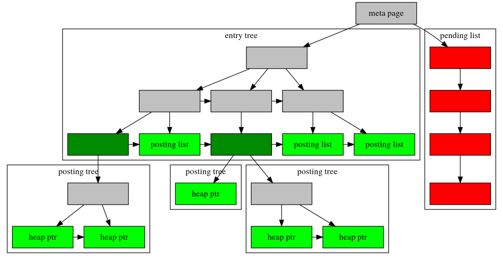

## 65.4. GIN 索引 [#](#GIN)

[65.4.1. 簡介](gin.md#GIN-INTRO)

[65.4.2. 內建運算子類別](gin.md#GIN-BUILTIN-OPCLASSES)

[65.4.3. 擴充性](gin.md#GIN-EXTENSIBILITY)

[65.4.4. 實作](gin.md#GIN-IMPLEMENTATION)

[65.4.5. GIN 使用提示與技巧](gin.md#GIN-TIPS)

[65.4.6. 限制](gin.md#GIN-LIMIT)

[65.4.7. 範例](gin.md#GIN-EXAMPLES)

### 65.4.1. 簡介 [#](#GIN-INTRO)

GIN 是 Generalized Inverted Index（通用倒排索引）的縮寫。GIN 的設計目的是處理下列情況：要被索引的項目是複合值，而索引要處理的查詢需要搜尋出現在複合項目中的元素值。例如，項目可以是文件，而查詢可以是搜尋包含特定字詞的文件。

我們用*項目*（item）一詞指稱要被索引的複合值，用*鍵*（key）一詞指稱元素值。GIN 一律儲存並搜尋鍵，而不是項目值本身。

GIN 索引儲存一組 (鍵, posting list) 配對，其中 *posting list* 是該鍵所出現之資料列的資料列 ID 集合。同一個資料列 ID 可以出現在多個 posting list 中，因為一個項目可以包含超過一個鍵。每個鍵值只會儲存一次，因此在同一個鍵出現許多次的情況下，GIN 索引非常精簡。

GIN 的「通用」是指 GIN 存取方法的程式碼不需要知道它所加速的具體操作。它改為使用針對特定資料型別所定義的自訂策略。策略定義了如何從被索引的項目與查詢條件中擷取鍵，以及如何判斷一個包含查詢中部分鍵值的資料列是否真的滿足查詢。

GIN 的優點之一，是它讓資料型別領域的專家（而非資料庫專家）能夠開發具有適當存取方法的自訂資料型別。這與使用 GiST 的優點大致相同。

PostgreSQL 中的 GIN 實作主要由 Teodor Sigaev 與 Oleg Bartunov 維護。在他們的[網站](http://www.sai.msu.su/~megera/wiki/Gin)上有更多關於 GIN 的資訊。

### 65.4.2. 內建運算子類別 [#](#GIN-BUILTIN-OPCLASSES)

PostgreSQL 核心發行版本包含[表 65.3](gin.md#GIN-BUILTIN-OPCLASSES-TABLE) 所列的 GIN 運算子類別。（[附錄 F](../../appendixes/contrib/README.md) 中所述的部分選用模組提供了額外的 GIN 運算子類別。）

**表 65.3. 內建 GIN 運算子類別**

<table border="1" class="table" summary="內建 GIN 運算子類別"><colgroup><col/><col/></colgroup><thead><tr><th>名稱</th><th>可索引運算子</th></tr></thead><tbody><tr><td rowspan="4" valign="middle"><code class="literal">array_ops</code></td><td><code class="literal">&amp;&amp; (anyarray,anyarray)</code></td></tr><tr><td><code class="literal">@&gt; (anyarray,anyarray)</code></td></tr><tr><td><code class="literal">&lt;@ (anyarray,anyarray)</code></td></tr><tr><td><code class="literal">= (anyarray,anyarray)</code></td></tr><tr><td rowspan="6" valign="middle"><code class="literal">jsonb_ops</code></td><td><code class="literal">@&gt; (jsonb,jsonb)</code></td></tr><tr><td><code class="literal">@? (jsonb,jsonpath)</code></td></tr><tr><td><code class="literal">@@ (jsonb,jsonpath)</code></td></tr><tr><td><code class="literal">? (jsonb,text)</code></td></tr><tr><td><code class="literal">?| (jsonb,text[])</code></td></tr><tr><td><code class="literal">?&amp; (jsonb,text[])</code></td></tr><tr><td rowspan="3" valign="middle"><code class="literal">jsonb_path_ops</code></td><td><code class="literal">@&gt; (jsonb,jsonb)</code></td></tr><tr><td><code class="literal">@? (jsonb,jsonpath)</code></td></tr><tr><td><code class="literal">@@ (jsonb,jsonpath)</code></td></tr><tr><td valign="middle"><code class="literal">tsvector_ops</code></td><td><code class="literal">@@ (tsvector,tsquery)</code></td></tr></tbody></table>

 

在 `jsonb` 型別的兩個運算子類別中，`jsonb_ops` 是預設的。`jsonb_path_ops` 支援的運算子較少，但對這些運算子提供較佳的效能。詳細資訊請參閱[第 8.14.4 節](../../the-sql-language/datatype/datatype-json.md#JSON-INDEXING)。

### 65.4.3. 擴充性 [#](#GIN-EXTENSIBILITY)

GIN 介面具有高度的抽象性，只要求存取方法的實作者實作所存取資料型別的語意。GIN 層本身會負責並行處理、日誌記錄以及樹狀結構的搜尋。

要讓 GIN 存取方法運作，只需要實作幾個使用者定義的方法，這些方法定義了樹中鍵的行為，以及鍵、被索引的項目與可索引查詢之間的關係。簡而言之，GIN 結合了擴充性與通用性、程式碼重用，以及簡潔的介面。

GIN 的運算子類別必須提供兩個方法：

`Datum *extractValue(Datum itemValue, int32 *nkeys, bool **nullFlags)`
:   給定一個要被索引的項目，傳回一個以 palloc 配置的鍵陣列。傳回的鍵數量必須存入 `*nkeys`。如果任何鍵可能為 null，還要以 palloc 配置一個包含 `*nkeys` 個 `bool` 欄位的陣列，將其位址存入 `*nullFlags`，並視需要設定這些 null 旗標。如果所有鍵都不是 null，`*nullFlags` 可以保持為 `NULL`（其初始值）。如果項目不含任何鍵，傳回值可以是 `NULL`。

`Datum *extractQuery(Datum query, int32 *nkeys, StrategyNumber n, bool **pmatch, Pointer **extra_data, bool **nullFlags, int32 *searchMode)`
:   給定一個要查詢的值，傳回一個以 palloc 配置的鍵陣列；也就是說，`query` 是可索引運算子右側的值，而該運算子的左側是被索引的欄位。`n` 是該運算子在運算子類別中的策略編號（請參閱[第 36.16.2 節](../../server-programming/extend/xindex.md#XINDEX-STRATEGIES)）。`extractQuery` 通常需要參考 `n` 來判斷 `query` 的資料型別，以及應該用來擷取鍵值的方法。傳回的鍵數量必須存入 `*nkeys`。如果任何鍵可能為 null，還要以 palloc 配置一個包含 `*nkeys` 個 `bool` 欄位的陣列，將其位址存入 `*nullFlags`，並視需要設定這些 null 旗標。如果所有鍵都不是 null，`*nullFlags` 可以保持為 `NULL`（其初始值）。如果 `query` 不含任何鍵，傳回值可以是 `NULL`。

    `searchMode` 是一個輸出引數，讓 `extractQuery` 可以指定搜尋執行方式的細節。如果 `*searchMode` 設為 `GIN_SEARCH_MODE_DEFAULT`（這是呼叫前它被初始化的值），則只有與至少一個傳回的鍵相符的項目才會被視為候選相符項目。如果 `*searchMode` 設為 `GIN_SEARCH_MODE_INCLUDE_EMPTY`，則除了包含至少一個相符鍵的項目之外，完全不含任何鍵的項目也會被視為候選相符項目。（例如，這個模式對於實作「是…的子集」運算子很有用。）如果 `*searchMode` 設為 `GIN_SEARCH_MODE_ALL`，則索引中所有非 null 的項目都會被視為候選相符項目，無論它們是否與任何傳回的鍵相符。（這個模式比其他兩種選擇慢得多，因為它基本上需要掃描整個索引，但為了正確實作邊界情況，它可能是必要的。在大多數情況下都需要這個模式的運算子，大概不適合作為 GIN 運算子類別。）用來設定此模式的符號定義在 `access/gin.h` 中。

    `pmatch` 是在支援部分比對時使用的輸出引數。要使用它，`extractQuery` 必須配置一個包含 `*nkeys` 個 `bool` 的陣列，並將其位址存入 `*pmatch`。如果對應的鍵需要部分比對，陣列中的每個元素應該設為 true，否則設為 false。如果 `*pmatch` 設為 `NULL`，GIN 會假設不需要部分比對。這個變數在呼叫前會被初始化為 `NULL`，因此不支援部分比對的運算子類別可以直接忽略這個引數。

    `extra_data` 是一個輸出引數，讓 `extractQuery` 可以將額外資料傳給 `consistent` 與 `comparePartial` 方法。要使用它，`extractQuery` 必須配置一個包含 `*nkeys` 個指標的陣列，並將其位址存入 `*extra_data`，然後將它想要的任何內容存入各個指標。這個變數在呼叫前會被初始化為 `NULL`，因此不需要額外資料的運算子類別可以直接忽略這個引數。如果設定了 `*extra_data`，整個陣列會傳給 `consistent` 方法，而對應的元素會傳給 `comparePartial` 方法。

運算子類別還必須提供一個函式，用來檢查被索引的項目是否與查詢相符。它有兩種形式：布林值的 `consistent` 函式，以及三值的 `triConsistent` 函式。`triConsistent` 涵蓋了兩者的功能，因此只提供 `triConsistent` 就足夠了。不過，如果布林值版本的計算成本明顯較低，同時提供兩者可能會有好處。如果只提供布林值版本，某些仰賴在擷取所有鍵之前就先排除索引項目的最佳化會被停用。

`bool consistent(bool check[], StrategyNumber n, Datum query, int32 nkeys, Pointer extra_data[], bool *recheck, Datum queryKeys[], bool nullFlags[])`
:   如果被索引的項目滿足策略編號為 `n` 的查詢運算子（或在傳回需要重新檢查的指示時，可能滿足它），則傳回 true。這個函式無法直接存取被索引項目的值，因為 GIN 不會明確儲存項目。它能取得的是：從查詢中擷取出的哪些鍵值出現在給定的被索引項目中。`check` 陣列的長度為 `nkeys`，與先前 `extractQuery` 針對這個 `query` datum 傳回的鍵數量相同。如果被索引的項目包含對應的查詢鍵，`check` 陣列中的對應元素即為 true；也就是說，若 (check[i] == true)，則 `extractQuery` 結果陣列中的第 i 個鍵出現在被索引的項目中。原始的 `query` datum 會傳入，以備 `consistent` 方法需要參考它；先前由 `extractQuery` 傳回的 `queryKeys[]` 與 `nullFlags[]` 陣列也會一併傳入。`extra_data` 是 `extractQuery` 傳回的額外資料陣列，若沒有則為 `NULL`。

    當 `extractQuery` 在 `queryKeys[]` 中傳回 null 鍵時，若被索引的項目包含 null 鍵，則對應的 `check[]` 元素為 true；也就是說，`check[]` 的語意類似於 `IS NOT DISTINCT
    FROM`。如果 `consistent` 函式需要區分一般值的相符與 null 的相符，可以檢查對應的 `nullFlags[]` 元素。

    成功時，如果需要針對查詢運算子重新檢查堆積 tuple，`*recheck` 應該設為 true；如果索引測試是精確的，則設為 false。也就是說，傳回值為 false 保證堆積 tuple 不符合查詢；傳回值為 true 且 `*recheck` 設為 false，保證堆積 tuple 確實符合查詢；而傳回值為 true 且 `*recheck` 設為 true，則表示堆積 tuple 可能符合查詢，因此需要擷取它，並直接對原本被索引的項目評估查詢運算子來重新檢查。

`GinTernaryValue triConsistent(GinTernaryValue check[], StrategyNumber n, Datum query, int32 nkeys, Pointer extra_data[], Datum queryKeys[], bool nullFlags[])`
:   `triConsistent` 與 `consistent` 類似，但 `check` 向量中的每個鍵不是布林值，而是有三種可能的值：`GIN_TRUE`、`GIN_FALSE` 與 `GIN_MAYBE`。`GIN_FALSE` 與 `GIN_TRUE` 的意義與一般布林值相同，而 `GIN_MAYBE` 表示不知道該鍵是否存在。當存在 `GIN_MAYBE` 值時，只有在無論索引項目是否包含對應的查詢鍵，該項目都確定相符的情況下，函式才應該傳回 `GIN_TRUE`。同樣地，只有在無論項目是否包含那些 `GIN_MAYBE` 鍵，該項目都確定不相符時，函式才必須傳回 `GIN_FALSE`。如果結果取決於 `GIN_MAYBE` 項目，也就是無法根據已知的查詢鍵確認或否定是否相符，函式必須傳回 `GIN_MAYBE`。

    當 `check` 向量中沒有 `GIN_MAYBE` 值時，傳回 `GIN_MAYBE` 相當於在布林值的 `consistent` 函式中設定 `recheck` 旗標。

此外，GIN 必須有辦法對索引中儲存的鍵值排序。運算子類別可以藉由指定比較方法來定義排序順序：

`int compare(Datum a, Datum b)`
:   比較兩個鍵（不是被索引的項目！），並傳回小於零、零或大於零的整數，分別表示第一個鍵小於、等於或大於第二個鍵。Null 鍵永遠不會傳給這個函式。

或者，如果運算子類別沒有提供 `compare` 方法，GIN 會查找該索引鍵資料型別的預設 btree 運算子類別，並使用其比較函式。對於只打算用於單一資料型別的 GIN 運算子類別，建議指定比較函式，因為查找 btree 運算子類別需要耗費一些 CPU 週期。不過，多型的 GIN 運算子類別（例如 `array_ops`）通常無法指定單一的比較函式。

GIN 的運算子類別可以選擇性地提供下列方法：

`int comparePartial(Datum partial_key, Datum key, StrategyNumber n, Pointer extra_data)`
:   將部分比對的查詢鍵與索引鍵進行比較。傳回一個整數，其正負號表示結果：小於零表示索引鍵不符合查詢，但索引掃描應該繼續；零表示索引鍵確實符合查詢；大於零表示索引掃描應該停止，因為不可能再有相符的項目。系統會提供產生該部分比對查詢之運算子的策略編號 `n`，以備需要依其語意判斷何時結束掃描。此外，`extra_data` 是 `extractQuery` 所建立之額外資料陣列中的對應元素，若沒有則為 `NULL`。Null 鍵永遠不會傳給這個函式。

`void options(local_relopts *relopts)`
:   定義一組使用者可見的參數，用以控制運算子類別的行為。

    `options` 函式會收到一個指向 `local_relopts` 結構的指標，該結構需要填入一組運算子類別專屬的選項。其他支援函式可以使用 `PG_HAS_OPCLASS_OPTIONS()` 與 `PG_GET_OPCLASS_OPTIONS()` 巨集存取這些選項。

    由於被索引值的鍵擷取方式，以及鍵在 GIN 中的表示方式都具有彈性，它們可能取決於使用者指定的參數。

為了支援「部分比對」查詢，運算子類別必須提供 `comparePartial` 方法，而且它的 `extractQuery` 方法在遇到部分比對查詢時必須設定 `pmatch` 參數。詳細資訊請參閱[第 65.4.4.2 節](gin.md#GIN-PARTIAL-MATCH)。

上述各種 `Datum` 值的實際資料型別會依運算子類別而不同。傳給 `extractValue` 的項目值一律屬於運算子類別的輸入型別，而所有鍵值都必須屬於該類別的 `STORAGE` 型別。傳給 `extractQuery`、`consistent` 與 `triConsistent` 的 `query` 引數，其型別是由策略編號所識別之類別成員運算子的右側輸入型別。只要能從中擷取出正確型別的鍵值，它就不必與被索引的型別相同。不過，建議這三個支援函式的 SQL 宣告對 `query` 引數使用該運算子類別的被索引資料型別，即使實際型別可能依運算子而是其他型別。

### 65.4.4. 實作 [#](#GIN-IMPLEMENTATION)

在內部，GIN 索引包含一個建構在鍵上的 B-tree 索引，其中每個鍵是一個或多個被索引項目的元素（例如陣列的成員），而葉節點頁面中的每個 tuple 所包含的，要麼是指向由堆積指標組成之 B-tree（「posting tree」）的指標，要麼是在清單小到足以與鍵值一起放進單一索引 tuple 時，由堆積指標組成的簡單清單（「posting list」）。[圖 65.1](gin.md#GIN-INTERNALS-FIGURE) 說明了 GIN 索引的這些組成部分。

從 PostgreSQL 9.1 開始，null 鍵值可以包含在索引中。此外，對於本身為 null，或依 `extractValue` 判定不含任何鍵的被索引項目，索引中也會包含作為預留位置的 null。這讓應該找到空項目的搜尋能夠找到它們。

多欄位 GIN 索引的實作方式，是在複合值（欄位編號, 鍵值）上建立單一的 B-tree。不同欄位的鍵值可以是不同的型別。

**圖 65.1. GIN 內部結構**

<figure><figcaption></figcaption></figure>

 

#### 65.4.4.1. GIN 快速更新技術 [#](#GIN-FAST-UPDATE)

由於倒排索引的本質，更新 GIN 索引往往很慢：插入或更新一筆堆積資料列，可能會導致對索引進行許多次插入（從被索引項目擷取出的每個鍵各一次）。GIN 能夠將這項工作的大部分延後，方法是將新的 tuple 插入一個暫存、未排序的待處理項目清單中。當資料表被執行 vacuum 或 autoanalyze 時、呼叫 `gin_clean_pending_list` 函式時，或待處理清單變得大於 [gin_pending_list_limit](../../server-administration/runtime-config/runtime-config-client.md#GUC-GIN-PENDING-LIST-LIMIT) 時，這些項目會以初次建立索引時所用的相同批次插入技術，移到主要的 GIN 資料結構中。即使把額外的 vacuum 負擔計算在內，這也大幅提升了 GIN 索引的更新速度。此外，這些額外負擔的工作可以由背景程序完成，而不是在前景的查詢處理中進行。

這種做法的主要缺點是，搜尋除了搜尋一般索引之外，還必須掃描待處理項目清單，因此龐大的待處理項目清單會使搜尋明顯變慢。另一個缺點是，雖然大多數更新都很快，但導致待處理清單變得「太大」的更新會立即引發一次清理週期，因而比其他更新慢得多。適當地使用 autovacuum 可以將這兩個問題降到最低。

如果一致的回應時間比更新速度更重要，可以關閉 GIN 索引的 `fastupdate` 儲存參數，以停用待處理項目。詳細資訊請參閱 [CREATE INDEX](../../reference/sql-commands/sql-createindex.md)。

#### 65.4.4.2. 部分比對演算法 [#](#GIN-PARTIAL-MATCH)

GIN 可以支援「部分比對」查詢，這類查詢不會為一個或多個鍵決定精確的相符，而是可能的相符落在一個相當窄的鍵值範圍內（依 `compare` 支援方法所決定的鍵排序順序）。`extractQuery` 方法不會傳回要精確比對的鍵值，而是傳回要搜尋之範圍下界的鍵值，並將 `pmatch` 旗標設為 true。接著使用 `comparePartial` 方法掃描該鍵範圍。對於相符的索引鍵，`comparePartial` 必須傳回零；對於不相符但仍在要搜尋之範圍內的索引鍵，傳回小於零的值；如果索引鍵已超出可能相符的範圍，則傳回大於零的值。

### 65.4.5. GIN 使用提示與技巧 [#](#GIN-TIPS)

建立與插入的比較
:   插入 GIN 索引可能很慢，因為每個項目可能都要插入許多鍵。因此，對資料表進行大量插入時，建議先移除 GIN 索引，並在大量插入完成後再重新建立。

    為 GIN 啟用 `fastupdate` 時（詳細資訊請參閱[第 65.4.4.1 節](gin.md#GIN-FAST-UPDATE)），代價會比未啟用時小。但對於非常大量的更新，移除並重新建立索引可能仍是最好的做法。

[maintenance_work_mem](../../server-administration/runtime-config/runtime-config-resource.md#GUC-MAINTENANCE-WORK-MEM)
:   GIN 索引的建置時間對 `maintenance_work_mem` 設定非常敏感；在建立索引期間吝於配置工作記憶體並不划算。

[gin_pending_list_limit](../../server-administration/runtime-config/runtime-config-client.md#GUC-GIN-PENDING-LIST-LIMIT)
:   在對已啟用 `fastupdate` 的現有 GIN 索引進行一連串插入期間，每當待處理項目清單變得大於 `gin_pending_list_limit` 時，系統就會清理該清單。為了避免觀察到的回應時間出現波動，最好讓待處理清單的清理在背景中進行（也就是透過 autovacuum）。可以藉由提高 `gin_pending_list_limit` 或讓 autovacuum 更積極，來避免前景的清理操作。不過，提高清理操作的門檻值意味著，如果真的發生前景清理，所需的時間會更長。

    可以藉由變更儲存參數，針對個別 GIN 索引覆寫 `gin_pending_list_limit`，讓每個 GIN 索引都有自己的清理門檻值。例如，可以只對可能被大量更新的 GIN 索引提高門檻值，而對其他索引則降低門檻值。

[gin_fuzzy_search_limit](../../server-administration/runtime-config/runtime-config-client.md#GUC-GIN-FUZZY-SEARCH-LIMIT)
:   開發 GIN 索引的主要目標，是在 PostgreSQL 中支援高度可擴展的全文檢索，而全文檢索經常會遇到傳回非常大量結果的情況。此外，這通常發生在查詢包含非常常見的字詞時，以致龐大的結果集甚至沒有用處。由於從磁碟讀取許多 tuple 並加以排序可能需要很長的時間，這在正式環境中是無法接受的。（請注意，索引搜尋本身非常快。）

    為了便於控制這類查詢的執行，GIN 對傳回的資料列數量有一個可設定的軟性上限：`gin_fuzzy_search_limit` 設定參數。預設值為 0（表示沒有限制）。如果設定了非零的限制，則傳回的集合會是從整個結果集中隨機選出的子集。

    「軟性」表示實際傳回的結果數量可能與指定的限制略有差異，取決於查詢以及系統亂數產生器的品質。

    根據經驗，數千左右的值（例如 5000 — 20000）效果良好。

### 65.4.6. 限制 [#](#GIN-LIMIT)

GIN 假設可索引運算子是嚴格的（strict）。這表示對於 null 項目值，完全不會呼叫 `extractValue`（而是自動建立一個預留位置的索引項目），對於 null 查詢值也不會呼叫 `extractQuery`（而是假設該查詢無法被滿足）。不過請注意，包含在非 null 複合項目或查詢值中的 null 鍵值是受支援的。

### 65.4.7. 範例 [#](#GIN-EXAMPLES)

PostgreSQL 核心發行版本包含先前[表 65.3](gin.md#GIN-BUILTIN-OPCLASSES-TABLE) 所列的 GIN 運算子類別。下列 `contrib` 模組也包含 GIN 運算子類別：

`btree_gin`
:   為多種資料型別提供等同於 B-tree 的功能

`hstore`
:   用於儲存 (鍵, 值) 配對的模組

`intarray`
:   強化對 `int[]` 的支援

`pg_trgm`
:   使用三字母組（trigram）比對的文字相似度

---

原文：[PostgreSQL 18.6 Documentation](https://www.postgresql.org/docs/18/gin.html)（原文版本：18.6；核對日期：2026-10-17）
