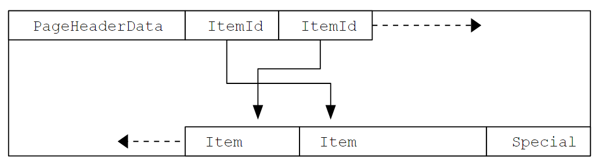

## 66.6. 資料庫頁面配置 [#](#storage-page-layout) 

[66.6.1. 資料表資料列配置](storage-page-layout.md#storage-tuple-layout)

本節概述 PostgreSQL 資料表與索引中所使用的頁面格式。[[19]](#ftn.id-1.10.18.8.2.2)序列與 TOAST 資料表的格式與一般資料表完全相同。

在以下的說明中，假設一個*位元組*包含 8 個位元。此外，*項目（item）*一詞指的是儲存在頁面上的個別資料值。在資料表中，一個項目就是一筆資料列；在索引中，一個項目就是一筆索引項目。

每個資料表與索引都儲存為一個由固定大小之*頁面*組成的陣列（通常為 8 kB，不過在編譯伺服器時可以選擇不同的頁面大小）。在資料表中，所有頁面在邏輯上都是相等的，因此特定的項目（資料列）可以儲存在任何頁面中。在索引中，第一個頁面通常保留作為存放控制資訊的*中繼頁面（metapage）*，而索引內可能會有不同類型的頁面，視索引存取方法而定。

[表 66.2](storage-page-layout.md#PAGE-TABLE) 顯示頁面的整體配置。每個頁面都有五個部分。

**表 66.2. 頁面整體配置**

<table border="1" class="table" summary="頁面整體配置"><colgroup><col/><col/></colgroup><thead><tr><th>
項目
</th><th>說明</th></tr></thead><tbody><tr><td>PageHeaderData</td><td>長度為 24 位元組。包含頁面的一般資訊，包括可用空間指標。</td></tr><tr><td>ItemIdData</td><td>指向實際項目的項目識別碼陣列。每個項目是一組（位移, 長度）配對。每個項目 4 位元組。</td></tr><tr><td>可用空間（Free space）</td><td>尚未配置的空間。新的項目識別碼從這個區域的開頭配置，新的項目則從結尾配置。</td></tr><tr><td>項目（Items）</td><td>實際的項目本身。</td></tr><tr><td>特殊空間（Special space）</td><td>索引存取方法專屬的資料。不同的方法儲存不同的資料。在一般資料表中為空。</td></tr></tbody></table>

 

每個頁面的前 24 個位元組是頁面標頭（`PageHeaderData`）。其格式詳見[表 66.3](storage-page-layout.md#PAGEHEADERDATA-TABLE)。第一個欄位追蹤與此頁面相關的最近一筆 WAL 項目。若啟用了[資料檢查碼](../../server-administration/wal/checksums.md)，第二個欄位會包含頁面檢查碼。接下來是一個包含旗標位元的 2 位元組欄位。之後是三個 2 位元組的整數欄位（`pd_lower`、`pd_upper` 與 `pd_special`）。它們分別包含從頁面開頭到未配置空間開頭、到未配置空間結尾，以及到特殊空間開頭的位元組位移。頁面標頭接下來的 2 個位元組 `pd_pagesize_version`，同時儲存頁面大小與版本標示。從 PostgreSQL 8.3 開始，版本號碼為 4；PostgreSQL 8.1 與 8.2 使用版本號碼 3；PostgreSQL 8.0 使用版本號碼 2；PostgreSQL 7.3 與 7.4 使用版本號碼 1；更早的版本使用版本號碼 0。（在這些版本中，大多數版本的基本頁面配置與標頭格式都沒有改變，但堆積資料列標頭的配置有所改變。）頁面大小基本上只是用來交叉核對；一個安裝中不支援使用超過一種頁面大小。最後一個欄位是一個提示，顯示修剪（prune）該頁面是否可能有益：它追蹤頁面上最舊的未修剪 XMAX。

**表 66.3. PageHeaderData 配置**

<table border="1" class="table" summary="PageHeaderData 配置"><colgroup><col/><col/><col/><col/></colgroup><thead><tr><th>欄位</th><th>型別</th><th>長度</th><th>說明</th></tr></thead><tbody><tr><td>pd_lsn</td><td>PageXLogRecPtr</td><td>8 位元組</td><td>LSN：此頁面最後一次變更之 WAL 紀錄最後一個位元組的下一個位元組</td></tr><tr><td>pd_checksum</td><td>uint16</td><td>2 位元組</td><td>頁面檢查碼</td></tr><tr><td>pd_flags</td><td>uint16</td><td>2 位元組</td><td>旗標位元</td></tr><tr><td>pd_lower</td><td>LocationIndex</td><td>2 位元組</td><td>到可用空間開頭的位移</td></tr><tr><td>pd_upper</td><td>LocationIndex</td><td>2 位元組</td><td>到可用空間結尾的位移</td></tr><tr><td>pd_special</td><td>LocationIndex</td><td>2 位元組</td><td>到特殊空間開頭的位移</td></tr><tr><td>pd_pagesize_version</td><td>uint16</td><td>2 位元組</td><td>頁面大小與配置版本號碼資訊</td></tr><tr><td>pd_prune_xid</td><td>TransactionId</td><td>4 位元組</td><td>頁面上最舊的未修剪 XMAX，若沒有則為零</td></tr></tbody></table>

 

所有細節都可以在 `src/include/storage/bufpage.h` 中找到。

頁面標頭之後是項目識別碼（`ItemIdData`），每個需要四個位元組。項目識別碼包含到項目開頭的位元組位移、項目以位元組計的長度，以及一些會影響其解讀方式的屬性位元。新的項目識別碼會視需要從未配置空間的開頭配置。目前存在的項目識別碼數量可以透過查看 `pd_lower` 來判斷，配置新的識別碼時會增加這個值。由於項目識別碼在被釋放之前永遠不會移動，因此即使項目本身為了壓縮可用空間而在頁面上移動，仍可長期使用該識別碼的索引來參照該項目。事實上，PostgreSQL 所建立的每一個指向項目的指標（`ItemPointer`，也稱為 `CTID`）都是由頁面編號與項目識別碼的索引所組成。

項目本身儲存在從未配置空間結尾往回配置的空間中。確切的結構會因資料表要包含的內容而異。資料表與序列都使用名為 `HeapTupleHeaderData` 的結構，說明如下。

最後一個區段是「特殊區段」，可以包含存取方法想要儲存的任何內容。例如，b-tree 索引會儲存指向頁面左右相鄰頁面的連結，以及一些與索引結構相關的其他資料。一般資料表完全不使用特殊區段（藉由將 `pd_special` 設定為等於頁面大小來表示）。

[圖 66.1](storage-page-layout.md#STORAGE-PAGE-LAYOUT-FIGURE) 說明這些部分在頁面中的配置方式。

**圖 66.1. 頁面配置**

<figure><figcaption></figcaption></figure>

 

### 66.6.1. 資料表資料列配置 [#](#storage-tuple-layout) 

所有資料表資料列的結構都相同。有一個固定大小的標頭（在大多數機器上佔 23 個位元組），接著是選用的 null 點陣圖、選用的物件 ID 欄位，以及使用者資料。標頭詳見[表 66.4](storage-page-layout.md#HEAPTUPLEHEADERDATA-TABLE)。實際的使用者資料（資料列的欄位）從 `t_hoff` 所指示的位移開始，這個位移必須永遠是該平台 MAXALIGN 距離的倍數。只有在 `t_infomask` 中設定了 *HEAP_HASNULL* 位元時，才會有 null 點陣圖。若存在，它會緊接在固定標頭之後開始，並佔用足夠的位元組，讓每個資料欄位各有一個位元（也就是位元數等於 `t_infomask2` 中的屬性數量）。在這個位元清單中，1 位元表示非 null，0 位元表示 null。當點陣圖不存在時，所有欄位都會被視為非 null。只有在 `t_infomask` 中設定了 *HEAP_HASOID_OLD* 位元時，才會有物件 ID。若存在，它會出現在緊接 `t_hoff` 邊界之前的位置。為了讓 `t_hoff` 成為 MAXALIGN 的倍數所需的任何填補，都會出現在 null 點陣圖與物件 ID 之間。（這也進而確保物件 ID 有適當的對齊。）

**表 66.4. HeapTupleHeaderData 配置**

<table border="1" class="table" summary="HeapTupleHeaderData 配置"><colgroup><col/><col/><col/><col/></colgroup><thead><tr><th>欄位</th><th>型別</th><th>長度</th><th>說明</th></tr></thead><tbody><tr><td>t_xmin</td><td>TransactionId</td><td>4 位元組</td><td>插入時的 XID 戳記</td></tr><tr><td>t_xmax</td><td>TransactionId</td><td>4 位元組</td><td>刪除時的 XID 戳記</td></tr><tr><td>t_cid</td><td>CommandId</td><td>4 位元組</td><td>插入以及／或刪除時的 CID 戳記（與 t_xvac 共用同一空間）</td></tr><tr><td>t_xvac</td><td>TransactionId</td><td>4 位元組</td><td>VACUUM 操作搬移資料列版本時的 XID</td></tr><tr><td>t_ctid</td><td>ItemPointerData</td><td>6 位元組</td><td>此資料列版本或較新資料列版本目前的 TID</td></tr><tr><td>t_infomask2</td><td>uint16</td><td>2 位元組</td><td>屬性數量，加上各種旗標位元</td></tr><tr><td>t_infomask</td><td>uint16</td><td>2 位元組</td><td>各種旗標位元</td></tr><tr><td>t_hoff</td><td>uint8</td><td>1 位元組</td><td>到使用者資料的位移</td></tr></tbody></table>

 

所有細節都可以在 `src/include/access/htup_details.h` 中找到。

只有使用從其他資料表（主要是 `pg_attribute`）取得的資訊，才能解讀實際的資料。識別欄位位置所需的關鍵值是 `attlen` 與 `attalign`。除非只有固定寬度的欄位而且沒有 null 值，否則無法直接取得特定的屬性。這些技巧全都包裝在函式 *heap_getattr*、*fastgetattr* 與 *heap_getsysattr* 中。

要讀取資料，你需要依序檢查每個屬性。首先根據 null 點陣圖檢查該欄位是否為 NULL。如果是，就前往下一個。接著確認對齊是否正確。若該欄位是固定寬度欄位，那麼所有位元組都是直接放置的。若它是可變長度欄位（attlen = -1），就會稍微複雜一些。所有可變長度資料型別都共用通用的標頭結構 `struct varlena`，其中包含所儲存之值的總長度與一些旗標位元。視旗標而定，資料可能是內嵌（inline）的，也可能位於 TOAST 資料表中；它也可能經過壓縮（請參閱[第 66.2 節](storage-toast.md)）。

 

---

[[19]](#id-1.10.18.8.2.2) 
實際上，無論是資料表存取方法還是索引存取方法，都不一定要使用這種頁面格式。`heap` 資料表存取方法一律使用這種格式。所有現有的索引方法也都使用這種基本格式，但保存在索引中繼頁面上的資料通常不遵循項目配置規則。

---

原文：[PostgreSQL 18.6 Documentation](https://www.postgresql.org/docs/18/storage-page-layout.html)（原文版本：18.6；核對日期：2026-10-17）
